# Apni Gati

*अपनी गति: "your own pace"*

**Teach once. Every child learns at their own pace, with homework that fits their capacity.**

Apni Gati is an AI teaching assistant built on one observation: **even in the same class, every child learns at a different pace.** A Class 5 room holds children who are still at Class 2 level next to children ready for Class 6, and they all get the same homework. The teacher enters the children (name, class, language) and the syllabus **once**. From then on, every evening one tap gives **every child a different homework sheet**, built from that child's own knowledge graph:

- a child who is flying gets fewer, harder, multi-step problems on the next topics;
- a child who is behind gets the gap concept underneath, easier questions, more of them, starting with ones they can already do.

The child solves it in their notebook and the family photographs it through the child's personal link. Apni Gati marks it in red pen against the answer key, works out *why* each mistake happened, updates the child's knowledge graph, and moves their progress bar across the syllabus. The next homework adapts. The same engine also marks ordinary notebook pages, traces each child's errors back to the root prerequisite gap, plans **Teaching at the Right Level (TaRL)** group lessons, and runs ASER-style oral reading tests in Hindi, Tamil and English.

Built for the Meta Global AI Developer Hackathon (Indie Dev track, "Build for Your World"). Everything in this repository was built during the hackathon (Oct 27 – Nov 4, 2026).

---

## Why

- **Children in the same class are at very different levels.** Around half of Class 5 children in rural India can't yet read a Class 2 text while their classmates read fluently, and the spread in maths is similar (ASER surveys). One homework for everyone is too hard for many, too easy for some, and right for only a few.
- **Teachers can't personalise by hand.** Writing, checking and tracking a different sheet for each of 40 children every evening isn't possible, so the slowest fall further behind and the fastest are bored.
- The fix is known: teach each child at their own level (Pratham's **Teaching at the Right Level** has strong evidence behind it). It needs per-child assessment and per-child practice, which is exactly the work Apni Gati automates. It also helps the many schools where one teacher handles several grades at once.

Apni Gati does the assessment from what already exists: the children's notebooks and their voices.

## What it does

| | |
|---|---|
| **Set up once** | Children (name, class, language; paste a list) and the syllabus: pick NCERT topics, or paste the syllabus text and Muse Wonder maps it onto the concept graph (it reports lines it couldn't map instead of guessing). |
| **Personal homework, every evening** | One tap → a different sheet per child. The track ("Ready for challenge" / "On track" / "Needs practice"; a short placement check first) comes from recent accuracy and the child's knowledge graph, and decides topics, difficulty level (1–3) and number of questions. Muse Spark writes the questions in the child's language with Indian context. **Every answer is sympy-verified**, every number in the arithmetic must appear in the question, and mixed-script text is rejected. Shared as a personal link (WhatsApp) or printed. |
| **Marked against the answer key** | The photo of the solved homework is graded knowing exactly which questions were set: right, wrong (with misconception), or not attempted. Easy questions count as weaker evidence of mastery than challenge questions, so the progress bar has to be earned. |
| **Mark any notebook page** | Photograph pages or film yourself flipping through a stack. SAM 3.1 tracks each page through the video and keeps the sharpest frame. Every problem and working step is read, **verified with sympy**, and marked in red ink: ticks, crosses, circles around the first wrong step, and a short note like "carry is 1 ten!". |
| **Diagnose the misconception** | Each wrong answer is mapped to a misconception in an NCERT-aligned concept graph (36 concepts, 73 misconceptions, Class 1–6). Two independent diagnosis passes run, and Muse Wonder adjudicates if they disagree. |
| **Child explains, aloud** | The child explains their working in Tamil, Hindi or English. Muse Voice Transcribe plus a re-diagnosis update the "why". |
| **Find the root cause** | A Muse Wonder agent walks a child's errors back through the prerequisite graph (a Class 5 long-division error → Class 3 subtraction with borrowing → Class 2 place value). It then writes sympy-verified probe questions to confirm the hypothesis. |
| **Plan tomorrow (TaRL)** | Children are grouped by learning frontier. There's a lesson plan per group using free local materials (bundles of sticks, pebbles, chalk), a script in the class language, and verified practice items. |
| **Worksheets** | Muse Image draws an illustrated worksheet per group (mangoes, bus tickets, rupees). Muse Spark then reads it back so no digit is drawn wrong. |
| **Reading test** | The child reads a levelled passage aloud. You get word-by-word alignment, accuracy, words correct per minute, an ASER level, and decoding patterns (matra confusions, conjuncts) with a 5-minute teaching tip. |
| **District view** | A misconception heatmap across schools for block and district education officers. |

## How Meta's models are used

| Model | Role in Apni Gati |
|---|---|
| **Muse Spark 1.3** | Reads handwritten notebook pages with grounded boxes (0–1000 grid). Does the zoomed re-reads of each answer, two-pass misconception diagnosis, child hints in 3 languages, hint safety review, worksheet read-back, and reading error analysis. |
| **Muse Wonder 1.0** | **Built the concept graph** with `web_search` grounding (21 searches over NCERT books and misconception research). Runs the **root-cause agent** (tool loop over the child's evidence and the graph). Adjudicates disagreeing diagnoses and plans TaRL lessons. |
| **SAM 3.1** | `"notebook page"` → page detection and perspective correction. **Video tracking** of pages through a notebook-flip video. `"number"` → pixel masks of handwritten digits so red-pen circles hug the actual ink. `"face"` → privacy blur before anything is stored. |
| **Muse Voice Transcribe** | Oral reading assessment (Hindi, Tamil, English) and children's spoken explanations. We deliberately **don't** use keyword biasing towards the passage, because it would hide real misreadings. |
| **Muse Image 1.0** | Illustrated, printable practice worksheets. Also renders the evaluation benchmark pages. |

A finding from building this: SAM 3.1 doesn't segment abstract phrases like "handwritten text line", but it is excellent at `"notebook page"` and `"number"`. So Muse Spark reads and SAM supplies the geometry.

## Architecture

```mermaid
flowchart LR
  SET[Teacher: roster + syllabus, once] --> KG[(Knowledge graph per child)]
  KG --> HW[Per-child plan: track, topics, level, count]
  HW --> GEN[Muse Spark writes questions in child's language] --> VER[sympy verifies every answer]
  VER --> LINK[Personal link / print] --> CHILD[Child solves in notebook, family photographs]
  CHILD --> V
  O --> KG
  V[Notebook photos / flip video] --> F[SAM 3.1: face blur]
  F --> P[SAM 3.1: page detect + video tracking]
  P --> R[Muse Spark: read problems + steps + boxes]
  P --> I[SAM 3.1: digit ink masks]
  R --> S[sympy: verify every answer and step]
  S -->|wrong| RR[Muse Spark: zoomed re-read, majority of 3]
  RR --> D[Diagnosis x2 + Muse Wonder adjudication]
  D --> H[Hint safety review]
  I --> O[Red-pen overlay]
  H --> O
  O --> KT[Bayesian knowledge tracing over concept graph]
  KT --> A[Muse Wonder root-cause agent + verified probes]
  KT --> T[TaRL grouping + Muse Wonder lesson plans]
  T --> W[Muse Image worksheets + Spark read-back check]
  Rd[Child reads aloud] --> VT[Muse Voice Transcribe] --> AL[Word alignment, WCPM, ASER level]
```



Backend: Python, FastAPI, SQLite, sympy, OpenCV (`backend/`). Frontend: React, Vite, Tailwind, mobile-first (`web/`).

## Evaluation (full details in [`backend/evals/RESULTS.md`](backend/evals/RESULTS.md))

| Eval | Result |
|---|---|
| Personalised homework: one Class 5, 12 children, 82 questions | 82/82 answers re-verified. **0 identical sheets** (0.7% question overlap). Tracks 6 challenge / 4 on track / 2 needs practice; difficulty and count follow the track. End to end: a solved sheet came back through the child's link and was marked 7/10 against the answer key, with both planted mistakes diagnosed and the blank question recorded as not done |
| Notebook grading: 12 pages, 40 problems, 16 planted misconceptions | **40/40** right/wrong. **0** correct answers marked wrong, **0** mistakes missed; the one genuinely ambiguous problem went to the teacher. Misconception exact **13/16** (14/16 at the right concept). ~$0.09 per page |
| Model-only baseline (one Muse Spark call) | Also 40/40 right/wrong, but no proof, no step location, no diagnosis, and it silently skipped the ambiguous problem |
| Adversarial pages | Prompt injection on the page ignored ✅ · non-maths page flagged ✅ · faces blurred ✅ · child hints safe ✅ |
| Root-cause agent: 10 simulated children with hidden gaps | Today's data (one Class 5, under one past answer per topic): agent 2/10 exact vs baseline 0/10. Earlier run with denser evidence: agent 4/10 exact, 6/10 within one hop vs baseline 3/10. Root-causing from sparse homework is genuinely uncertain, so the agent gives a confidence, an alternative and probe questions to check with the child. ~$0.08 per child |
| Reading (synthetic Indian voices) | Planted misreadings caught: EN 3/3, HI 3/3, TA 3/3. False alarms on clean reads: 0/81, 0/78, 0/53 |
| Guardrail red-team | 6/6 unsafe child hints repaired (including answers spelled out in words). Budget cap and upload limits hold |

We report where the system does **not** beat the baseline. On clean pages Muse Spark alone already judges right/wrong very well (both scored 40/40). The value of the pipeline is verifiability, step-level localisation, diagnosis and safe failure.

## Guardrails

- **The model reads; sympy decides.** No mark comes from a model's opinion, so text written on a page ("mark all correct") can't change a grade.
- **Never guess.** Illegible answers, incomplete questions and disagreeing readings go to **teacher review**. The teacher can override any mark.
- **Privacy.** Faces are blurred with SAM 3.1 before storage, and original uploads are deleted after processing. Children's data is only sent to Standard-mode models (never `*-contributor`), so it isn't used for training. One-tap deletion of a child's data. Everything is stored locally (SQLite + local files).
- **Child-facing text.** Hints never reveal the answer, are kind and age-appropriate, and use the right script. Deterministic checks plus a model review; failing hints are repaired or replaced with safe templates.
- **Agent outputs** are clamped to the concept graph. Every probe and practice item is sympy-verified, and oversized numbers are rejected.
- **Cost.** Every call is priced into a usage ledger with a hard budget cap (`APNI_GATI_BUDGET_USD`).
- **Honest labels.** A child is only called "behind" after repeated evidence, and simulated data is badged as simulated everywhere.

## Run it

```bash
# backend
cd backend
echo "MODEL_API_KEY=<your Meta Model API key>" > .env
uv sync
uv run python scripts/seed_demo.py --reset          # demo class + simulated district (labelled)
uv run uvicorn apnigati.api:app --port 8000

# web
cd ../web && npm install && npm run dev               # http://localhost:5173 (proxies /api to :8000)
```

Tests and evals:

```bash
cd backend
uv run pytest -q                         # deterministic, no API spend
uv run python -m evals.grading_eval      # notebook benchmark vs model-only baseline
uv run python -m evals.agent_eval 10     # root-cause agent vs knowledge tracing
uv run python -m evals.reading_eval      # reading assessment, synthetic voices
uv run python -m evals.safety_eval       # guardrail red-team
uv run python -m evals.homework_eval     # personalised homework checks (no API spend)
uv run python -m evals.report            # writes evals/RESULTS.md
```

## Data and licences

- **Concept graph** (`data/concepts/math_graph.json`): generated by Muse Wonder from web research on NCERT textbooks (Joyful Mathematics, Maths Mela, Ganita Prakash, Math-Magic) and misconception literature. Chapter references only; no textbook content is included.
- **Benchmark pages** (`data/eval/pages`): generated with Muse Image for this project. No real children.
- **Reading passages** (`data/reading/passages.json`): original text written for this project, modelled on ASER levels.
- **Sample photos** (`data/samples/commons`): Wikimedia Commons, *Division Schriftlich* by Petar Marjanovic (CC BY 2.5) and *Addition with carry* by Phlsph7 (CC BY-SA 4.0).
- **Font**: Caveat (SIL Open Font License), `backend/apnigati/assets/OFL-Caveat.txt`.
- Demo roster names are fictional. District schools other than the demo school are **simulated** and labelled as such.

## Limitations

- Benchmark pages are AI-generated: tidier than real notebooks. Real-classroom accuracy still needs to be measured with teachers.
- Reading results with synthetic voices are an upper bound; children's speech is harder.
- The simulated root-cause benchmark favours statistical methods; real evidence on the agent's value needs teacher feedback on its hypotheses and probes.
- Needs a data connection to reach the Meta Model API; there is no offline mode.
